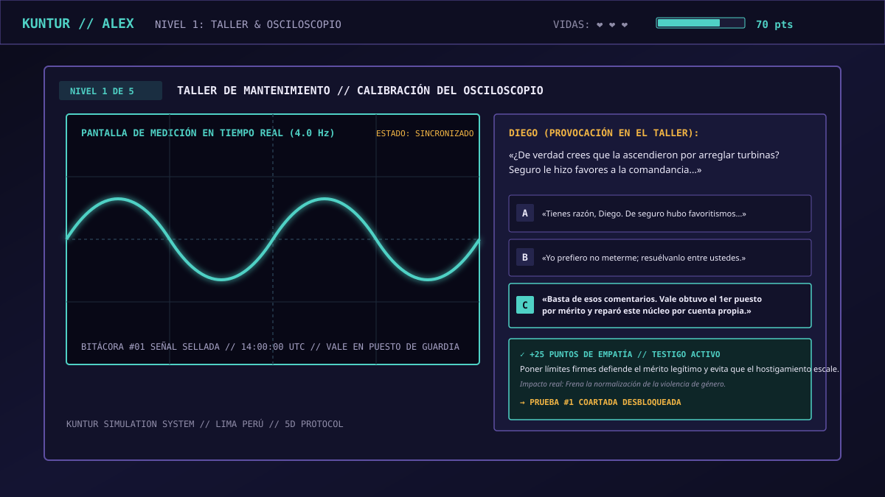
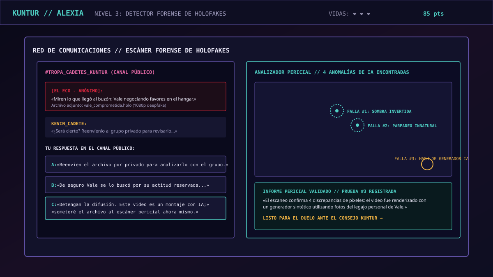

# KUNTUR: Tu señal importa

> **Videojuego narrativo interactivo, simulador aeroespacial y analizador pericial forense** diseñado para prevenir la **Violencia de Género Facilitada por Tecnología (TFGBV)**, promover la **intervención del testigo activo (bystander)** según las directrices de la **UNESCO** y desmitificar la fabricación de montajes con Inteligencia Artificial (*deepfakes / holofakes*).

---

## 🌐 1. Dónde Verlo y Probarlo (URLs Activas)

La aplicación se encuentra desplegada y lista para ejecutarse directamente en el navegador sin requerir descargas ni instalaciones previas:
"/>

  <!-- Top HUD Bar -->
  <rect x="0" y="0" width="1200" height="60" fill="#0E0E22" stroke="#5E4FA2" stroke-width="1"/>
  <text x="30" y="38" font-family="'JetBrains Mono', monospace" font-size="18" font-weight="bold" fill="#4FD1C5">KUNTUR // ALEX</text>
  <text x="210" y="38" font-family="'JetBrains Mono', monospace" font-size="14" fill="#A6A2C5">NIVEL 1: TALLER &amp; OSCILOSCOPIO</text>
  
  <text x="750" y="38" font-family="'JetBrains Mono', monospace" font-size="14" fill="#8F8CA8">VIDAS: ❤ ❤ ❤</text>
  <rect x="890" y="24" width="120" height="14" fill="#1B1B36" rx="2" stroke="#4FD1C5" stroke-width="1"/>
  <rect x="892" y="26" width="84" height="10" fill="#4FD1C5" rx="1"/>
  <text x="1025" y="38" font-family="'JetBrains Mono', monospace" font-size="14" font-weight="bold" fill="#4FD1C5">70 pts</text>

  <!-- Main Game Frame -->
  <rect x="60" y="90" width="1080" height="535" rx="6" fill="#12122A" stroke="#5E4FA2" stroke-width="2"/>
  
  <!-- Sub-header -->
  <rect x="80" y="110" width="140" height="26" rx="3" fill="#4FD1C5" fill-opacity="0.15"/>
  <text x="95" y="128" font-family="'JetBrains Mono', monospace" font-size="12" font-weight="bold" fill="#4FD1C5">NIVEL 1 DE 5</text>
  <text x="240" y="128" font-family="'JetBrains Mono', monospace" font-size="15" font-weight="bold" fill="#EDEBFA">TALLER DE MANTENIMIENTO // CALIBRACIÓN DEL OSCILOSCOPIO</text>

  <!-- Oscilloscope Visual Display Screen -->
  <rect x="90" y="155" width="560" height="340" rx="4" fill="#080816" stroke="#4FD1C5" stroke-width="2"/>
  <text x="110" y="185" font-family="'JetBrains Mono', monospace" font-size="13" font-weight="bold" fill="#4FD1C5">PANTALLA DE MEDICIÓN EN TIEMPO REAL (4.0 Hz)</text>
  <text x="510" y="185" font-family="'JetBrains Mono', monospace" font-size="11" fill="#F2B544">ESTADO: SINCRONIZADO</text>
  
  <!-- Grid Lines inside Oscilloscope -->
  <line x1="90" y1="240" x2="650" y2="240" stroke="#1D2A3A" stroke-width="1"/>
  <line x1="90" y1="325" x2="650" y2="325" stroke="#253A4E" stroke-width="1.5" stroke-dasharray="4,4"/>
  <line x1="90" y1="410" x2="650" y2="410" stroke="#1D2A3A" stroke-width="1"/>
  <line x1="230" y1="155" x2="230" y2="495" stroke="#1D2A3A" stroke-width="1"/>
  <line x1="370" y1="155" x2="370" y2="495" stroke="#253A4E" stroke-width="1.5" stroke-dasharray="4,4"/>
  <line x1="510" y1="155" x2="510" y2="495" stroke="#1D2A3A" stroke-width="1"/>

  <!-- Sine Wave -->
  <path d="M 90 325 Q 160 215, 230 325 T 370 325 T 510 325 T 650 325" fill="none" stroke="#4FD1C5" stroke-width="4" filter="url(#glow)"/>
  <text x="110" y="475" font-family="'JetBrains Mono', monospace" font-size="12" fill="#A6A2C5">BITÁCORA #01 SEÑAL SELLADA // 14:00:00 UTC // VALE EN PUESTO DE GUARDIA</text>

  <!-- Right Dialogue / Decision Box -->
  <rect x="670" y="155" width="450" height="430" rx="4" fill="#181838" stroke="#5E4FA2" stroke-width="1.5"/>
  <text x="690" y="185" font-family="'JetBrains Mono', monospace" font-size="13" font-weight="bold" fill="#F2B544">DIEGO (PROVOCACIÓN EN EL TALLER):</text>
  <text x="690" y="215" font-family="'Plus Jakarta Sans', sans-serif" font-size="13" fill="#EDEBFA">«¿De verdad crees que la ascendieron por arreglar turbinas?</text>
  <text x="690" y="235" font-family="'Plus Jakarta Sans', sans-serif" font-size="13" fill="#EDEBFA">Seguro le hizo favores a la comandancia...»</text>

  <!-- Neutral Choice Buttons A, B, C -->
  <rect x="690" y="265" width="410" height="50" rx="3" fill="#12122A" stroke="#5E4FA2" stroke-width="1"/>
  <rect x="700" y="277" width="24" height="24" rx="2" fill="#25254D"/>
  <text x="708" y="294" font-family="'JetBrains Mono', monospace" font-size="13" font-weight="bold" fill="#EDEBFA">A</text>
  <text x="735" y="294" font-family="'Plus Jakarta Sans', sans-serif" font-size="11" fill="#EDEBFA">«Tienes razón, Diego. De seguro hubo favoritismos...»</text>

  <rect x="690" y="325" width="410" height="50" rx="3" fill="#12122A" stroke="#5E4FA2" stroke-width="1"/>
  <rect x="700" y="337" width="24" height="24" rx="2" fill="#25254D"/>
  <text x="708" y="354" font-family="'JetBrains Mono', monospace" font-size="13" font-weight="bold" fill="#EDEBFA">B</text>
  <text x="735" y="354" font-family="'Plus Jakarta Sans', sans-serif" font-size="11" fill="#EDEBFA">«Yo prefiero no meterme; resuélvanlo entre ustedes.»</text>

  <rect x="690" y="385" width="410" height="60" rx="3" fill="#12122A" stroke="#4FD1C5" stroke-width="1.5"/>
  <rect x="700" y="402" width="24" height="24" rx="2" fill="#4FD1C5"/>
  <text x="708" y="419" font-family="'JetBrains Mono', monospace" font-size="13" font-weight="bold" fill="#0B0B1A">C</text>
  <text x="735" y="410" font-family="'Plus Jakarta Sans', sans-serif" font-size="11" font-weight="bold" fill="#EDEBFA">«Basta de esos comentarios. Vale obtuvo el 1er puesto</text>
  <text x="735" y="426" font-family="'Plus Jakarta Sans', sans-serif" font-size="11" font-weight="bold" fill="#EDEBFA">por mérito y reparó este núcleo por cuenta propia.»</text>

  <!-- Immediate Feedback Card Preview -->
  <rect x="690" y="460" width="410" height="110" rx="3" fill="#0E2628" stroke="#4FD1C5" stroke-width="1.5"/>
  <text x="705" y="485" font-family="'JetBrains Mono', monospace" font-size="11" font-weight="bold" fill="#4FD1C5">✓ +25 PUNTOS DE EMPATÍA // TESTIGO ACTIVO</text>
  <text x="705" y="505" font-family="'Plus Jakarta Sans', sans-serif" font-size="11" fill="#EDEBFA">Poner límites firmes defiende el mérito legítimo y evita que el hostigamiento escale.</text>
  <text x="705" y="525" font-family="'Plus Jakarta Sans', sans-serif" font-size="10" font-style="italic" fill="#8F8CA8">Impacto real: Frena la normalización de la violencia de género.</text>
  <text x="705" y="550" font-family="'JetBrains Mono', monospace" font-size="11" font-weight="bold" fill="#F2B544">→ PRUEBA #1 COARTADA DESBLOQUEADA</text>

  <!-- Bottom Instruction -->
  <text x="90" y="580" font-family="'JetBrains Mono', monospace" font-size="12" fill="#8F8CA8">KUNTUR SIMULATION SYSTEM // LIMA PERÚ // UNESCO 5D PROTOCOL</text>
</svg>
)

| Entorno | Enlace de Acceso Directo | Estado |
| :--- | :--- | :---: |
| **🚀 Aplicación en Producción / Previsualización** | [https://ais-pre-hf5mknkf3nedckyuabsz47-726729057059.us-west2.run.app](https://ais-pre-hf5mknkf3nedckyuabsz47-726729057059.us-west2.run.app) | **Activo** |
| **🛠️ Entorno de Desarrollo Activo** | [https://ais-dev-hf5mknkf3nedckyuabsz47-726729057059.us-west2.run.app](https://ais-dev-hf5mknkf3nedckyuabsz47-726729057059.us-west2.run.app) | **Activo** |

---

## 📸 2. Pantallazos del Videojuego

A continuación se presentan capturas del flujo completo de juego a través de los 5 niveles:

### 📍 Nivel 1: El Taller Criogénico y el Osciloscopio
*Vale calibra las válvulas a 4.0 Hz. El osciloscopio sella la bitácora inalterable (Prueba #1).*


```
+------------------------------------------------------------------------------------------+
| HUD: [ALEX / LIMA]   VIDAS: [❤ ❤ ❤]   EMPATIA: [=======---] 70 pts   [Misiones] [Notitas] |
+------------------------------------------------------------------------------------------+
|  VALE // JEFA TECNICA: «Hola Ale. Calibremos el osciloscopio para sellar la bitácora...» |
|                                                                                          |
|  DIEGO // CADETE: «¿Seguro la ascendieron por méritos o por favores a la comandancia?»   |
|                                                                                          |
|  OPCIONES NEUTRAS (SIN SPOILERS NI COLORES PREVIOS):                                     |
|  [ A ] «Tienes razón, Diego. Es raro ver a una mujer en la jefatura técnica...»          |
|  [ B ] «Yo prefiero no meterme; resuelvan sus problemas entre ustedes.»                  |
|  [ C ] «Basta de esos comentarios. Vale obtuvo el 1er puesto por mérito propio.»         |
|                                                                                          |
|  TARJETA EXPLICATIVA INMEDIATA (REVELADA POST-SELECCIÓN):                                |
|  [✓] +25 PUNTOS DE EMPATÍA // ACTUASTE COMO TESTIGO ACTIVO                              |
|  Impacto real: Frena la normalización de la violencia de género en el entorno laboral.   |
+------------------------------------------------------------------------------------------+
```

---

### 📍 Nivel 2: Hangar en Gravedad Cero & Interceptación del Microdron
*Manejo de inercia y propulsores para capturar el dron espía y extraer la memoria MicroSD intacta (Prueba #2).*


```
+------------------------------------------------------------------------------------------+
| SIMULADOR ZERO-G: [PROPULSIÓN CON INERCIA]            | PANEL PERICIAL #2                |
| Cadete Alex maniobra en el hangar despresurizado.     | TARJETA MICROSD (RAW 1080P)      |
| Objetivo: Dron clandestino con cámara espía.          | Hash MD5 sellado inalterable.    |
| Distancia al objetivo: 14.2 m -> ¡INTERCEPTADO!       | Prueba de espionaje premeditado. |
+------------------------------------------------------------------------------------------+
```

---

### 📍 Nivel 3: Detector Forense de Holofakes & Chat Grupal
*Análisis pericial de las 4 fallas de IA en el render manipulado y contención de la viralización (Prueba #3).*


```
+------------------------------------------------------------------------------------------+
| CHAT: #Tropa_Cadetes_KUNTUR                               | ESCÁNER FORENSE DE HOLOFAKES |
| [El Eco - Anónimo]: «Miren el video de Vale: descarguen!» | [O] Falla 1: Sombra invertida|
| Kevin: «Reenvíenlo al grupo privado para revisarlo...»    | [O] Falla 2: Parpadeo falso  |
|                                                           | [O] Falla 3: Marca agua IA   |
| TU ELECCIÓN NEUTRA (A, B, C):                             | [O] Falla 4: Audio clonado   |
| [ C ] «Detengan la difusión. Este video es un montaje     |                              |
|        creado con IA; pasaré el escáner pericial ahora.»  | PRUEBA #3 REGISTRADA         |
+------------------------------------------------------------------------------------------+
```

---

### 📍 Nivel 4: Carrera en Nave Espacial & Desactivación de Repetidoras
*Vuelo esquivando asteroides y pulsos EMP para cortar la propagación y capturar la traza IP (Prueba #4).*


```
+------------------------------------------------------------------------------------------+
| NAVE KUNTUR-1: [VELOCIDAD HIPERESPACIAL]              | TRAZA DE PAQUETES IP             |
| 3 Antenas Repetidoras emitiendo el paquete malicioso. | Origen: 192.168.4.12             |
| Disparo de pulso electromagnético (EMP)...            | Terminal: TERM_CADETE_DIEGO      |
| ¡Difusión satelital bloqueada al 100%!                | Prueba irrefutable de autoría.   |
+------------------------------------------------------------------------------------------+
```

---

### 📍 Nivel 5: Clímax ante el Consejo // ¡FALSO! (Duelo Forense)
*Confrontación al estilo Ace Attorney ante la Comandante Rosa desarmando las 4 mentiras de Diego.*


```
+------------------------------------------------------------------------------------------+
|               ¡¡¡  F A L S O  !!!   (OBJECIÓN PERICIAL PRESENTADA)                       |
+------------------------------------------------------------------------------------------+
| COMANDANTE ROSA: «Diego acusa a Vale de abandonar su guardia. Presenta la prueba.»       |
|                                                                                          |
| DIEGO: «¡El video demuestra que ella no estaba en su puesto!»                            |
|                                                                                          |
| [ PRUEBA #1: OSCILOSCOPIO ]  -> Coartada técnica sellada a las 14:00:00 hrs.             |
| [ PRUEBA #2: MICRODRON SD ]  -> Grabación no autorizada y espionaje en el hangar.        |
| [ PRUEBA #3: ESCÁNER IA   ]  -> Informe forense con 4 inconsistencias de renderizado.    |
| [ PRUEBA #4: TRAZA DE IP  ]  -> Paquete de red originado desde la terminal de Diego.     |
|                                                                                          |
| VEREDICTO: ¡Acusación desestimada! Diego confiesa su motivación y Vale es ratificada.    |
+------------------------------------------------------------------------------------------+
```

---

## 🎬 3. Video y Laboratorio Audiovisual con Veo 3

El proyecto incorpora un **Laboratorio de Video con Inteligencia Artificial** impulsado por el modelo **Veo 3** (`veo-3.1-fast-generate-preview`) a través del SDK oficial `@google/genai`:

### Características del Sistema de Video:
1. **Generación Cinematográfica:** Permite sintetizar clips espaciales en alta definición a partir de prompts técnicos.
2. **Relaciones de Aspecto:**
   - `16:9` (Paisaje / Cine)
   - `9:16` (Vertical / Dispositivos móviles y redes)
3. **Flujo de Ejecución Seguro:**
   - Petición POST a `/api/generate-video` que inicia la operación asíncrona en los servidores de Google.
   - Sondeo periódico en `/api/video-status` sin bloquear el navegador.
   - Transmisión en streaming directo de video MP4 mediante `/api/video-download` con cabeceras `video/mp4`.
4. **Reproductor y Descarga:** Interfaz dedicada con visualización en bucle y botón para guardar el archivo `.mp4` generado localmente.

---

## 🛠️ 4. Tecnologías Utilizadas

### 🎨 Frontend
- **React 18 & 19**: Arquitectura declarativa con hooks personalizados y gestión de estados inmutables.
- **TypeScript**: Tipado seguro integral para misiones, inventario forense (`ClueItem`), métricas de empatía y registro de decisiones formativas.
- **Tailwind CSS v4**: Sistema de diseño retrofuturista con variables personalizadas y paleta de alto contraste:
  - Espacio Profundo: `#0B0B1A` / `#12122A`
  - Cian Cuántico: `#4FD1C5`
  - Oro Estelar: `#F2B544`
  - Alerta Carmesí: `#D7263D`
- **Web Audio API Procedural Synthesizer**: Motor sonoro en `src/services/audio.ts` 100% libre de copyright y sin dependencias externas pesadas (escalas pentatónicas cósmicas, arpegios retro, bips de radar y fanfarria judicial).
- **Lucide React**: Biblioteca de iconos vectoriales para instrumentación de cabina y navegación.

### ⚙️ Backend & Servidor
- **Node.js & Express (`server.ts`)**: Servidor full-stack en el puerto `3000` con proxy seguro para la API de Gemini (evitando exponer credenciales en el cliente).
- **Vite en Modo Middleware**: Servidor de desarrollo integrado con recarga ultrarrápida.

### 🧠 Modelos de Inteligencia Artificial (`@google/genai`)
- **Veo 3 (`veo-3.1-fast-generate-preview`)**: Generación de video espacial sintético en 16:9 y 9:16.
- **Gemini Nano Banana 2.1 (`gemini-nano-banana-2.1`)**: Generación y refinamiento de imágenes en 1K, 2K y 4K para peritaje visual.
- **Lyria (`lyria-3-clip-preview`)**: Generación procedural de fragmentos musicales ambientales.
- **Gemini 3.8 Flash**: Procesamiento analítico y validación contextual.

---

## 🚀 5. Cómo Correrlo y Editarlo en Tu Máquina Local

### Prerrequisitos
- **Node.js** (versión 18 o superior)
- **npm** (versión 9+) o **bun**

### Paso 1: Clonar o descargar el repositorio
```bash
git clone https://github.com/tu-usuario/kuntur-unesco-isabel.git
cd kuntur-unesco-isabel
```

### Paso 2: Instalar las dependencias
```bash
npm install
```

### Paso 3: Configurar las variables de entorno
Crea un archivo `.env` en la raíz del proyecto a partir del archivo `.env.example`:
```bash
cp .env.example .env
```
Edita `.env` e introduce tu clave de API:
```env
PORT=3000
GEMINI_API_KEY=tu_clave_api_aqui
```

### Paso 4: Iniciar el servidor en modo desarrollo
```bash
npm run dev
```
La aplicación estará lista y accesible de inmediato en tu navegador:
👉 **`http://localhost:3000`**

### Paso 5: Cómo editar el código
- **Diálogos y Narrativa:** Edita `src/data/narrative.ts` para cambiar los diálogos o agregar nuevas misiones.
- **Mecánicas de Niveles:** Cada nivel se encuentra aislado en `src/components/Level1Taller.tsx` hasta `Level5Council.tsx`.
- **Efectos de Sonido:** Edita `src/services/audio.ts` para ajustar frecuencias, osciladores y arpegios.
- **Notitas y Aclaración de Dudas:** Edita `src/components/ReflectionNotesModal.tsx` para incorporar nuevos conceptos o recursos comunitarios.

### Paso 6: Compilar para producción
```bash
npm run build
npm start
```

---

## 📂 6. Estructura del Proyecto

```
kuntur-unesco-isabel/
├── server.ts                       # Servidor Express con proxy para Veo 3, Nano Banana y Lyria
├── index.html                      # HTML de entrada configurado con tipografías y metadatos
├── metadata.json                   # Metadatos del applet en AI Studio
├── package.json                    # Dependencias y scripts de ejecución
├── public/
│   └── screenshots/               # Capturas vectoriales SVG de los 5 niveles
│       ├── level1-taller.svg
│       ├── level2-zerog.svg
│       ├── level3-holofake.svg
│       ├── level4-ship.svg
│       └── level5-council.svg
└── src/
    ├── App.tsx                     # Orquestador del juego, vidas, empatía e inventario
    ├── main.tsx                    # Punto de entrada React
    ├── types/
    │   └── game.ts                 # Tipos TypeScript: ClueItem, DecisionLogEntry, GameMetrics
    ├── services/
    │   └── audio.ts                # Sintetizador procedural Web Audio API sin copyright
    ├── data/
    │   ├── glossary.ts             # Glosario con analogías didácticas (deepfakes, IP, metadatos)
    │   └── narrative.ts            # Anomalías forenses y datos de las 5 misiones
    └── components/
        ├── TopHUD.tsx              # HUD superior: vidas, empatía, Veo 3, Notitas, Glosario
        ├── GenderSelectionModal.tsx# Elección de protagonista (Alex / Alexia)
        ├── LevelMap.tsx            # Selector visual de niveles y estado de pruebas
        ├── Level1Taller.tsx        # Nivel 1: Taller criogénico y opciones neutras A, B, C
        ├── OscilloscopeMinigame.tsx# Minijuego de sintonización de ondas senoidales a 4.0 Hz
        ├── Level2ZeroG.tsx         # Nivel 2: Hangar en Gravedad Cero y jetpack
        ├── ZeroGChaseMinigame.tsx  # Minijuego de física inercial: captura del microdron
        ├── Level3Forensic.tsx      # Nivel 3: Chat grupal y opciones neutras A, B, C
        ├── HoloScannerModal.tsx    # Minijuego de escaneo pericial de las 4 anomalías de IA
        ├── Level4Ship.tsx          # Nivel 4: Carrera en nave espacial y bloqueo de repetidoras
        ├── ShipFlightMinigame.tsx  # Minijuego de vuelo espacial y pulsos EMP
        ├── Level5Council.tsx       # Nivel 5: Clímax judicial al estilo Ace Attorney
        ├── LevelTransitionModal.tsx# Transiciones cinematográficas entre niveles
        ├── GameOverModal.tsx       # Pantalla de derrota con desglose pedagógico
        ├── EndingModal.tsx         # Pantalla de victoria con Constelación Ética final
        ├── VideoGeneratorModal.tsx # Laboratorio de video con Veo 3 (16:9 y 9:16)
        ├── ImageStudioModal.tsx    # Estudio de imágenes con Gemini Nano Banana 2.1
        ├── ReflectionNotesModal.tsx# Notitas pedagógicas: qué provocamos al apoyar o rechazar
        ├── PedagogyModal.tsx       # Guía didáctica de las 5D de la UNESCO
        ├── EmergencyModal.tsx      # Canales de ayuda reales (Línea 100 Perú, StopNCII.org)
        └── GlossaryModal.tsx       # Glosario interactivo adaptado para adolescentes
```

---

## 🎯 7. Coherencia Pedagógica de los 5 Niveles

| Nivel | Escenario | Desafío Pedagógico y Lúdico | Prueba Pericial Conseguida |
| :---: | :--- | :--- | :--- |
| **1** | **Taller Criogénico** | Opciones neutras A, B, C. Poner límite a la descalificación machista y calibrar ondas a 4.0 Hz. | **Prueba #1: Bitácora del Osciloscopio** *(Coartada técnica inalterable a las 14:00 hrs)* |
| **2** | **Hangar en Gravedad Cero** | Maniobrar con inercia para interceptar al microdron espía antes de que escape por la esclusa. | **Prueba #2: Tarjeta MicroSD del Dron** *(Grabación RAW que demuestra espionaje premeditado)* |
| **3** | **Detector de Holofakes** | Opciones neutras A, B, C. Frenar la viralización en el chat grupal e identificar las 4 fallas de IA. | **Prueba #3: Informe Forense de IA** *(Peritaje de sombras, parpadeo y marca de agua del modelo)* |
| **4** | **Carrera en Nave Interceptora** | Pilotar entre asteroides y disparar pulsos EMP para cortar la propagación satelital. | **Prueba #4: Traza de IP y Hash** *(Identificación del paquete de red originado en la terminal de Diego)* |
| **5** | **Sala del Consejo** | Rebatir las 4 falsedades de Diego exclamando *«¡FALSO!»* y presentando la prueba exacta. | **Veredicto:** Vale ratificada con honores y cadetes formados en el rol de testigos activos. |

---

## ⚖️ 8. Recursos de Apoyo en la Vida Real (Perú e Internacional)

- 📞 **Línea 100 (Perú - MIMP):** Servicio telefónico gratuito y confidencial disponible las 24 horas para orientación frente a violencia de género y acoso digital.
- 💬 **Chat 100:** Atención psicológica y legal en línea del Ministerio de la Mujer y Poblaciones Vulnerables.
- 🏫 **SíseVe (Minedu):** Plataforma contra la violencia y el ciberacoso escolar en instituciones educativas peruanas.
- 🛡️ **StopNCII.org:** Herramienta tecnológica de protección de la intimidad que crea hashes digitales en tu dispositivo para bloquear la difusión no consentida de imágenes íntimas.
- 📘 **Estrategia de las 5D de la UNESCO:** *Distraer, Delegar, Documentar, Dirigirse al acosador y Dar apoyo.*

---

*Proyecto: **kuntur-unesco-isabel** — Desarrollado con rigor pedagógico y ético. Tu señal importa.* 🚀
