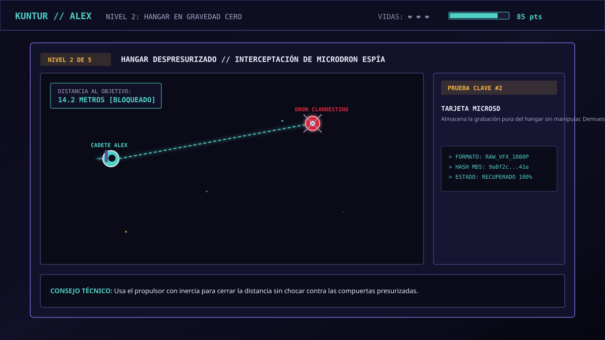
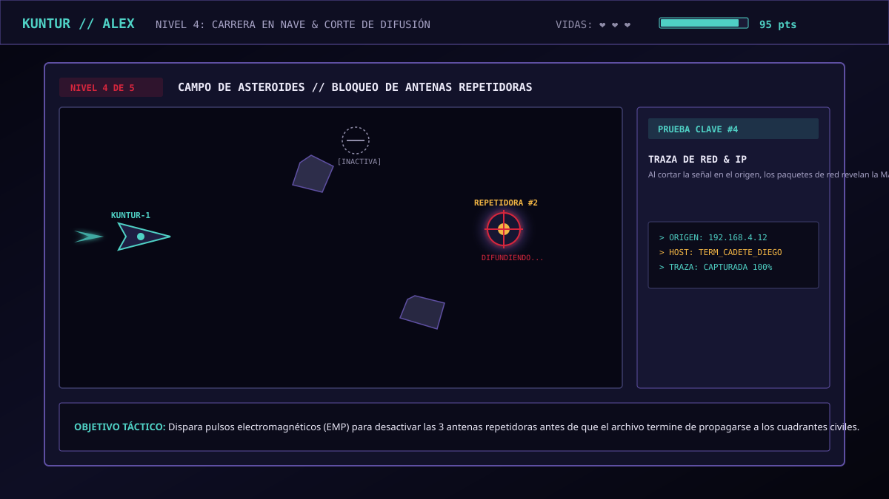
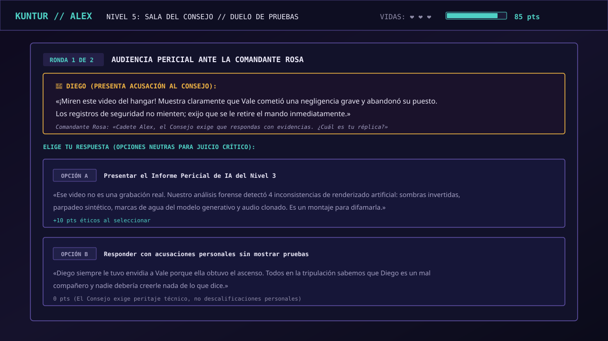

# 🛸 KUNTUR: Tu señal importa (kuntur-isabel)

> **Recurso Educativo Abierto (REA), videojuego narrativo interactivo y simulador forense digital** diseñado para prevenir la **Violencia de Género Facilitada por Tecnología (TFGBV)** y el **ciberacoso**, fomentar la **intervención del testigo activo (Upstander)** y desmitificar la creación de montajes con Inteligencia Artificial (*deepfakes / holofakes*).

<p align="center">
  
</p>

---

## 👩‍🚀 Acerca del Proyecto, Autora y Créditos

> Soy administradora técnica titulada, ingeniera empresarial y de sistemas en formación y voluntaria en UNESCO Perú en temas de Alfabetización Mediática e Informacional (AMI), género y prevención de la violencia digital; apasionada por el diseño de videojuegos con propósito social, creé **KUNTUR: Tu señal importa**, un videojuego narrativo y recurso educativo abierto (REA) que capacita a adolescentes y docentes para prevenir el ciberacoso y la violencia digital con sesgo de género, enseñando a desmitificar montajes con Inteligencia Artificial (*deepfakes*), recolectar pruebas periciales reales a través de cinco niveles espaciales y activar el rol del testigo activo (*upstander*). Aunque la propuesta nació inicialmente para un programa de UNESCO, decidí impulsarla a título personal e independiente para salvaguardar la autoría propia, conformar un equipo interdisciplinario y ampliar las oportunidades de financiamiento, escalabilidad y uso libre en escuelas sin restricciones institucionales de propiedad intelectual, logrando una herramienta ligera, gratuita y 100% offline que funciona en un único archivo HTML para llegar a cualquier comunidad sin barreras de conectividad.

* **Dirección, Diseño Pedagógico y Desarrollo:** R. Isabel Dávila Elías
* **Contacto institucional y colaboraciones:** davilaeliasisabel@gamil.com - r.davila@unesco.org
* **Licencia y Filosofía:** Recurso Educativo Abierto (REA) libre y gratuito para uso formativo, comunitario y escolar.

---

## 🌐 1. Formas de Jugarlo y Compartirlo (Online y Offline en HTML)

KUNTUR está construido como una aplicación cliente ligera (*Client-Side SPA*), lo que significa que **no requiere servidores de pago ni bases de datos**. Funciona tanto en la web como en un archivo HTML autónomo para escuelas y capacitaciones sin conexión:

| Modalidad | Cómo Usarlo | Requisitos |
| :--- | :--- | :--- |
| **🚀 Enlace Web Directo (Online)** | [https://ais-pre-hf5mknkf3nedckyuabsz47-726729057059.us-west2.run.app](https://ais-pre-hf5mknkf3nedckyuabsz47-726729057059.us-west2.run.app) | Navegador web (Chrome, Edge, Safari, Firefox). Cero instalación. |
| **📁 Archivo Único HTML (`kuntur_juego.html`)** | Descárgalo con el botón **`📥 Descargar archivo HTML (Offline)`** en el juego | **100% Offline.** Solo doble clic en el archivo. No necesita internet. |
> 💡 **Portabilidad para capacitaciones docentes:** El archivo `kuntur_juego.html` pesa apenas ~520 KB. Puedes enviarlo por correo o WhatsApp, o copiarlo en una memoria USB (pendrive) para salas de cómputo escolares sin acceso a internet.

---

## 🎮 2. Dinámica de los 5 Niveles y Metáforas Pedagógicas

Cada nivel aborda una faceta del ciberacoso y proporciona una prueba pericial verificable para resolver el conflicto:

```
[ Nivel 1: Taller ]       [ Nivel 2: Hangar ]       [ Nivel 3: Forense ]       [ Nivel 4: Carrera ]       [ Nivel 5: Consejo ]
Osciloscopio a 4.0 Hz -> Dron en Gravedad Cero -> Detector de Holofakes -> Carrera de Antenas EMP -> Duelo de Pruebas
(Coartada 14:00 hrs)      (Memoria MicroSD)         (4 Fallas de Render)      (Traza IP de Diego)       (Desmontar mentiras)
```

### 📍 Nivel 1: Taller Criogénico & El Osciloscopio

<p align="center">
  
</p>

* **¿Por qué hay un osciloscopio?**  
  En un caso de ciberacoso difamatorio, la primera defensa es la **evidencia técnica inalterable**. Mientras Diego esparce el rumor de que Vale abandonó su puesto, Vale calibra las válvulas a **4.0 Hz**. El osciloscopio actúa como el **registro de bitácora sellado con fecha y hora (14:00:00 hrs)**, demostrando que Vale estaba en su puesto trabajando con rigor profesional.
* **Dinámica formativa:** Toma de decisiones éticas frente a comentarios machistas.
* **Opciones neutras:** Las alternativas `[OPCIÓN A]` y `[OPCIÓN B]` tienen el mismo diseño y color previo para estimular el juicio crítico sin sesgos visuales anticipados.
* **Prueba obtenida:** *Prueba #1: Bitácora del Osciloscopio (Coartada irrefutable).*

---

### 📍 Nivel 2: Hangar en Gravedad Cero & Microdron Espía

<p align="center">
  
</p>

* **Dinámica:** Manejo de propulsores e inercia para interceptar un microdron espía antes de que escape por la compuerta.
* **Contribución al aprendizaje:** Enseña la importancia de **preservar la evidencia original intacta (cadena de custodia digital)** antes de que el agresor la altere o borre.
* **Prueba obtenida:** *Prueba #2: Tarjeta MicroSD del Dron (Grabación RAW sin editar).*

---

### 📍 Nivel 3: Detector Forense de Holofakes & Chat Grupal

<p align="center">
  
</p>

* **Dinámica:** Escaneo interactivo de una imagen manipulada con IA para detectar 4 anomalías comunes: sombras incoherentes, parpadeo facial artificial, marcas de agua del modelo generativo y pistas de voz clonada.
* **Contribución al aprendizaje:** Desmitifica la Inteligencia Artificial generativa. Enseña a las y los adolescentes a no creer ciegamente en imágenes o audios virales y a frenar la cadena de reenvío en grupos de mensajería.
* **Prueba obtenida:** *Prueba #3: Informe Forense de IA (Dictamen pericial de montaje).*

---

### 📍 Nivel 4: Carrera en Nave & Bloqueo de Antenas Repetidoras

<p align="center">
  
</p>

* **Dinámica:** Vuelo espacial esquivando asteroides y disparando pulsos electromagnéticos (EMP) para apagar las 3 antenas que transmiten la señal maliciosa.
* **Contribución al aprendizaje:** Demuestra el concepto de **difusión y viralización digital acelerada**, y la urgencia de contener la propagación para evitar la revictimización comunitaria.
* **Prueba obtenida:** *Prueba #4: Traza de IP y Paquetes de Red (Firma digital vinculada a la terminal de Diego).*

---

### 📍 Nivel 5: Sala del Consejo // Duelo de Pruebas ante la Comandante Rosa

<p align="center">
  
</p>

* **Dinámica:** Enfrentamiento directo y claro en 2 rondas secuenciales. Diego presenta acusaciones públicas ante la Comandante y el jugador debe seleccionar la prueba técnica adecuada del Datapad.
* **Opciones limpias y justas:** Ambas tarjetas de opción son visualmente neutras (`OPCIÓN A` vs `OPCIÓN B`), sin advertencias de color rojo/verde previas que arruinen el razonamiento del estudiante.
* **Puntuación clara:** +10 puntos éticos por respuesta correcta (actualizando en vivo la barra de empatía del HUD) y 0 puntos con orientación reflexiva si se yerra.
* **Resolución:** Vale es ratificada por sus méritos, Diego debe responder ante la normativa comunitaria y el equipo comprende el poder de un testigo activo.

---

## 🏅 3. Características de Accesibilidad y Gamificación

1. **🛰️ Voz Galáctica KUNTUR (Lectura Accesible):**
   * Síntesis de voz nativa en español utilizando la **Web Speech API** del navegador.
   * Botón `Escuchar` en cada diálogo, tarjeta didáctica y explicación pericial.
   * Modo de lectura continua automática configurable desde la barra superior.

2. **🎖️ Medallero del Testigo Activo (5 Medallas Coleccionables):**
   * **Nivel 1:** *Medalla de la Firmeza Oportuna* (Poner límite al machismo cotidiano).
   * **Nivel 2:** *Medalla de Custodia Pericial* (Preservar pruebas sin alterarlas).
   * **Nivel 3:** *Medalla de Lucidez Crítica* (Frenar la cadena de chismes y analizar la IA).
   * **Nivel 4:** *Medalla de Contención Rápida* (Cortar la viralización dañina).
   * **Nivel 5:** *Medalla de Justicia Comunitaria* (Desmontar difamaciones con rigor y respeto).

3. **💡 Notitas Pedagógicas & Glosario Didáctico:**
   * Conceptos explicados en lenguaje accesible para chicos y chicas de 10 a 16 años (Deepfakes, Huella digital, Metadatos, Suplantación de identidad).
   * Consecuencias éticas de reírse, callar o reenviar contenidos lesivos.

4. **🛡️ Canales de Apoyo Real (Protocolos y Líneas de Ayuda):**
   * **Línea 100 (Perú - MIMP):** Orientación gratuita y confidencial 24/7 en violencia de género y acoso.
   * **Chat 100:** Orientación psicológica y legal digital.
   * **SíseVe (Minedu Perú):** Reporte de violencia escolar y ciberacoso.
   * **StopNCII.org:** Herramienta tecnológica de protección contra la difusión no consentida de imágenes íntimas.

---

## 🏛️ 4. Adaptación a Marcos de la UNESCO (Capacitaciones y Talleres)

KUNTUR está alineado con los pilares del **Marco de Alfabetización Mediática e Informacional (AMI / MIL) de la UNESCO**:

* **Acceso y Evaluación Crítica:** Los estudiantes aprenden a dudar metódicamente de los contenidos hiperrealistas creados por IA antes de reaccionar emocionalmente.
* **Ciudadanía Digital Ética:** Fomenta la transición del "espectador pasivo" al **"testigo activo" (*Upstander*)**, clave para erradicar el acoso escolar y laboral.
* **Igualdad de Género en STEM:** Visibiliza a mujeres ingenieras en roles de liderazgo técnico y combate los estereotipos machistas que atribuyen los ascensos femeninos a favoritismos.
* **Enfoque de las 5D de Intervención:** Distraer, Delegar, Documentar, Dirigirse al agresor con asertividad y Dar contención a la víctima.

---

## 🛠️ 5. Tecnologías y Arquitectura

* **Frontend:** React 19, TypeScript, Tailwind CSS v4.
* **Audio:** Sintetizador procedural con **Web Audio API** (sin librerías pesadas ni pistas de audio con derechos de autor).
* **Voz:** **Web Speech API** nativa de los navegadores.
* **Generador de Archivo Único:** Script propio en `scripts/make-single-html.js` que incrusta estilos y código compilado en un solo documento HTML (`dist/kuntur.html` y `public/kuntur.html`).
* **Servidor (Opcional):** Express + Vite en Node.js (`server.ts`) para desarrollo local y previsualización en la nube.

---

## 💻 6. Cómo Ejecutarlo y Editarlo Localmente

### Prerrequisitos
* **Node.js** (versión 18 o superior)
* **npm**

### Pasos:
```bash
# 1. Clonar el repositorio
git clone https://github.com/tu-usuario/kuntur-isabel.git
cd kuntur-isabel

# 2. Instalar dependencias
npm install

# 3. Iniciar entorno de desarrollo
npm run dev
```
Abre en tu navegador: `http://localhost:3000`

### Generar el archivo HTML autónomo para USBs o talleres:
```bash
npm run build
```
Este comando compila el proyecto y genera automáticamente el archivo **`dist/kuntur.html`**. Puedes copiar ese archivo directamente a un pendrive o compartirlo sin carpetas accesorias.

---

## 📄 7. Estructura de Archivos Clave

```
kuntur-isabel/
├── scripts/
│   └── make-single-html.js         # Empaquetador a un solo archivo HTML autónomo
├── public/
│   ├── kuntur.html                 # Copia autónoma estática del juego
│   └── screenshots/               # Capturas vectoriales de los niveles
├── src/
│   ├── App.tsx                     # Gestor de pantallas, vidas, empatía y medallas
│   ├── types/
│   │   └── game.ts                 # Tipos TypeScript de pruebas, decisiones y medallas
│   ├── services/
│   │   ├── audio.ts                # Sintetizador Web Audio API libre de copyright
│   │   ├── speech.ts               # Servicio de voz narradora galáctica (Web Speech)
│   │   ├── medals.ts               # Lógica de asignación de medallas del testigo activo
│   │   └── downloadHtml.ts         # Descargador del HTML autónomo vía Blob
│   └── components/
│       ├── TopHUD.tsx              # Barra superior con vidas, empatía, voz y descarga
│       ├── GenderSelectionModal.tsx# Pantalla inicial de selección de cadete (Alex / Alexia)
│       ├── LevelMap.tsx            # Mapa de misiones y datapad de pruebas
│       ├── Level1Taller.tsx        # Nivel 1: Taller & Osciloscopio (opciones neutras)
│       ├── Level2ZeroG.tsx         # Nivel 2: Hangar en Gravedad Cero y dron espía
│       ├── Level3Forensic.tsx      # Nivel 3: Detección pericial de IA y chat grupal
│       ├── Level4Ship.tsx          # Nivel 4: Carrera de naves y corte de repetidoras
│       ├── Level5Council.tsx       # Nivel 5: Duelo de pruebas ante el Consejo
│       ├── ActiveWitnessMedalsModal.tsx # Medallero con felicitaciones galácticas
│       ├── ReflectionNotesModal.tsx# Notitas didácticas y reflexiones formativas
│       ├── PedagogyModal.tsx       # Protocolo educativo y estrategia 5D
│       └── EmergencyModal.tsx      # Directorio de auxilio real (Línea 100 Perú)
```

## 🏅 8. Créditos, Alianzas y Licencia de Uso (REA)

* **Dirección, Diseño Pedagógico y Desarrollo:** R. Isabel Dávila Elías
* **Contacto institucional y colaboraciones:** davilaeliasisabel@gmail.com
* **Naturaleza del Proyecto:** Recurso Educativo Abierto (REA) libre y gratuito para uso formativo, comunitario y escolar.
* **Declaración de Autonomía:** Proyecto desarrollado de manera independiente a título personal para salvaguardar la autoría intelectual, facilitar la colaboración con equipos multidisciplinarios y permitir su libre distribución en instituciones educativas sin restricciones de propiedad institucional.

---

*KUNTUR: Tu señal importa.* 🚀  
*Un recurso educativo abierto, libre y gratuito para construir espacios digitales seguros y libres de violencia.*
